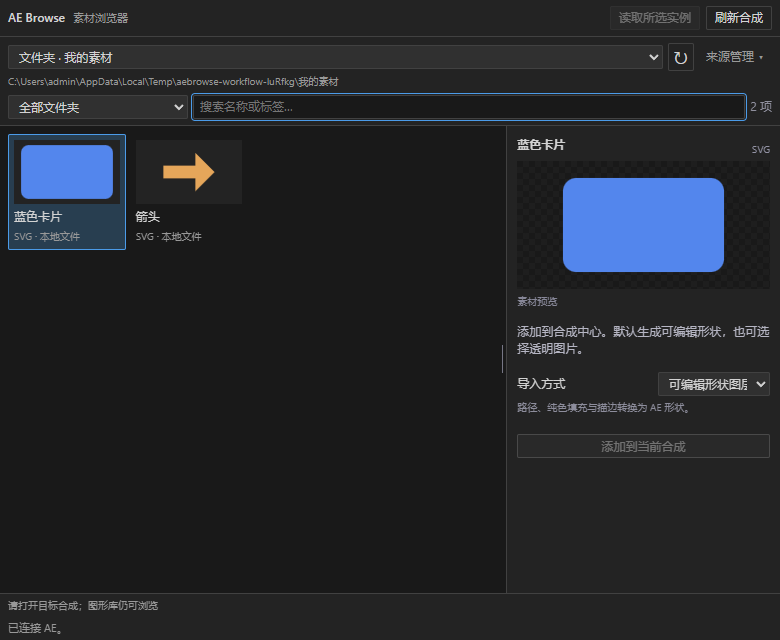

# AE Browse

用于 Adobe After Effects 的图形库浏览器。把图形整理成可复制的文件夹，在 CEP 面板中浏览、搜索和调整参数，再添加到当前合成。

当前版本 **0.2.0，开发版**。支持**圆角矩形、圆形、椭圆、三角形、六边形、星形**，每个实例为原生形状层。已接入所选实例读取与外观更新，保留原动画；六图形的真实 AE 属性和 CEP 事件处理器交互已验证，物理鼠标与停靠仍待专项验收。

2026-10-18 新增**普通本地素材文件夹**：无需 `pack.json`，支持 SVG、PNG、JPG/JPEG、子文件夹、文件名/路径搜索、缩略图与刷新。首次先设置路径，日常以素材浏览为主，来源添加与移除收进“来源管理”。面板使用 AE 风格的中性深灰和紧凑控件，恢复上次来源，宽窄布局分别记忆比例。**SVG 默认转换为可编辑形状层**，支持常见路径、基础图形、纯色填充、描边与复合路径；渐变、文字、裁剪等复杂内容需手动选择“透明图片”。见[本轮界面与 SVG 报告](docs/FOLDER_WORKFLOW_SVG_REPORT.md)。



## 项目路径

- 本机源码：`D:\project\ae-browse`
- GitHub 仓库：[MaShaoGER/ae-browse](https://github.com/MaShaoGER/ae-browse)
- 开发构建输出：`dist/AE Browse/`
- AE 开发扩展安装位置：`%APPDATA%\Adobe\CEP\extensions\local.aebrowse`
- 用户图形库登记：`%APPDATA%\AE Browse\libraries.json`

本机源码路径是当前工作目录，克隆到其他目录也可以构建和运行面板。部分实机测试辅助脚本仍使用这台机器的绝对路径，迁移后需要单独调整。

## 当前功能

- **拖入本地素材**：从资源管理器将文件夹或多个 SVG、PNG、JPG/JPEG 拖入面板。文件夹递归扫描；零散文件按来源目录归组，只登记实际拖入的文件。同目录再次拖入会合并，源文件不复制、不移动。拖入只加入浏览器，添加到 AE 合成仍点击按钮。
- **本地文件夹**：直接读取普通目录中的 SVG、PNG、JPG/JPEG；包含子目录，新增/修改文件后刷新即可。登记保存在 `folders.json`，不向源目录写入配置，移除登记不删除素材。
- **面板尺寸适配**：拖动列表与详情之间的分隔线；小于 551 像素宽时切换为上下分区。方向键微调、Home 或双击恢复默认比例；两区独立滚动。
- **图形库登记与恢复**：添加包含 `pack.json` 的文件夹；源文件只读，移除登记不会删除源图形库。
- **搜索与诊断**：按名称和标签搜索，显示中文提示、素材错误和依赖检查结果；损坏素材单独停用。
- **图形参数**：按类型调整宽高、直径、圆角、边数或角数、内外半径和旋转；共用颜色、时长与 `pop`、`slide`、`fade`、`none` 动画选择。
- **面板预览**：六种基础图形的近似外观预览，颜色使用面板选色器和预览色块。
- **导入与回读**：检查目标合成、素材内容指纹和参数，创建后读取实际图层属性。
- **实例编辑**：在 AE 选择一个工具实例，点击“读取所选实例”，修改外观后点击“更新所选图形”；保持图层身份和原动画，动画类型与时长锁定。
- **更新保护与恢复**：拒绝目标变化、旧快照、锁定、手工修改和来源变化；写入或回读失败时恢复原外观和实例信息，再回读确认。
- **执行保护**：宿主请求串行处理；创建请求超时后保留待确认状态，不自动重复创建。

当前以文件复制传播图形库，不需要在线素材服务。相同包身份的内容或版本冲突需要明确移除旧登记后再添加。

## 环境

| 用途 | 环境与范围 |
| --- | --- |
| 开发、构建与 Node 测试 | 已记录验证环境为 Node.js 24.18.0；源码不需要安装 npm 第三方依赖 |
| CEP 面板 | Windows、After Effects 26.x、CEP 12；manifest 限定 AE 26.x |
| 既有实机记录 | AE 26.0x67、CEP 12.0.1、CEP 内置 Node 17.7.2 |

构建使用仓库内固定版本的 Adobe `CSInterface.js`。面板运行使用 CEP 内置 Node，不依赖系统 Node 或 AE MCP。当前提供未签名的开发扩展，尚无正式 ZXP 安装包。

## 快速开始

### 1. 获取源码并构建

```powershell
git clone https://github.com/MaShaoGER/ae-browse.git
cd ae-browse
npm run build
```

已有本机项目时，进入 `D:\project\ae-browse` 后直接构建。输出到 `dist/AE Browse/`；每次构建会重建这个生成目录，请在 `cep/` 和 `src/` 中修改源码。

### 2. 在浏览器预览界面

```powershell
npm run preview
```

打开 <http://127.0.0.1:4311/?demo=1>。这是界面演示，不连接 AE，导入按钮关闭。结束时按 Ctrl+C。

### 3. 安装 AE 开发扩展

在项目根目录运行：

```powershell
.\scripts\install-dev.ps1
```

脚本将构建产物复制到上面的 AE 扩展安装位置。目标已存在时会停止，不覆盖旧扩展；升级时先备份旧目录并选择替换方式。

未签名扩展需要 CEP 的开发调试设置。确认使用 CEP 12 且需要启用时，可在首次安装时改用：

```powershell
.\scripts\install-dev.ps1 -EnableDebug
```

此开关会将 `HKCU\Software\Adobe\CSXS.12\PlayerDebugMode` 设置为字符串 `1`。安装完成后重新打开 AE，从“窗口 → 扩展”菜单打开 **AE Browse**。详见 [开发安装说明](docs/CEP_DEV_SETUP.md)。

### 4. 添加示例图形库

1. 使用最新构建时，在面板添加 `examples/basic-shapes/` 文件夹；本机完整路径为 `D:\project\ae-browse\examples\basic-shapes`。原圆角卡片示例 `examples/portable-demo/` 仍可使用。
2. 在 AE 打开目标合成，在面板点击“刷新合成”。
3. 选择图形，调整尺寸、颜色和动画参数。
4. 点击“添加到当前合成”，查看创建与回读结果。
5. 修改已有图形时，在 AE 选中一个本工具实例，点击“读取所选实例”，调整外观并点击“更新所选图形”。“添加副本到当前合成”仍创建独立实例。

没有活动合成时仍可浏览图形库。面板预览不包含真实效果栈与动画渲染，实际外观以 AE 为准。

### 图形包案例：讯号 SIGNAL

新增 [讯号 SIGNAL](examples/signal-kit/README.md)：面向科技资讯与栏目包装，包含 **12 个可编辑复合 SVG + 7 个参数图形预设**，附组合示意和 4 秒片头搭建建议。添加 `examples/signal-kit` 作为参数图形库；另将其中的 `svg` 文件夹作为普通素材来源添加。双击 `examples/signal-kit/preview.html` 可离线查看设计总览。素材不含文字，标题可在 AE 中另建和替换。

### 普通 SVG / 图片素材

也可直接把文件夹或多个素材文件拖到面板任意位置，看到接收提示后松开。不同来源目录会分别登记，可通过顶部下拉框切换；同一目录的零散文件显示为“散文件”。移除该登记不删除原文件。仅登记零散文件时，“刷新”重新读取已登记文件；新文件需要再次拖入，或另行添加整个文件夹。

1. 将素材放到自己的文件夹中；本机已准备 `D:\project\ae-browse\assets\local`，含示例 SVG 和使用说明。
2. 首次打开面板先选择或输入素材路径；已配置时，在“来源管理”中添加文件夹或输入路径。不需要制作 `pack.json`。
3. 点击缩略图，再点击“添加到当前合成”。SVG 默认生成可编辑形状图层，多个元素成为一个形状层内的分组，可直接在 AE 中编辑路径与外观。复杂 SVG 会明确提示，可手动改选“透明图片”；PNG/JPG 按图片导入。这些文件不使用参数图形包的实例更新功能。
4. 后续向目录添加、修改或删除素材后点击“刷新”。原文件保持独立，导入缓存保留在 `%APPDATA%\AE Browse\local-cache`，不要在工程仍引用缓存时删除。

当前读取上限：每文件 8 MB、每次目录扫描 64 MB、1000 个素材、10000 个目录项和 16 层子目录。链接目录跳过，脚本、外部资源、嵌入图片及实体声明等 SVG 内容停用；静态路径、填充、描边与内部渐变可用。SVG 文字应先转曲，复杂滤镜与外观以实际导入为准。

## 项目结构

```text
ae-browse/
├─ cep/                  CEP 面板、宿主通信桥、Node 图形库服务与 Adobe 依赖
├─ src/                  图形包校验器、ES3 计划编译器与 AE 执行层
├─ examples/             basic-shapes 六图形库与 portable-demo 圆角卡片库
├─ scripts/              构建、开发安装、界面演示与实机测试辅助脚本
├─ tests/                Node 检查与单独调用的 AE 宿主测试
├─ docs/                 协议、实现路径、安装说明与分层验证报告
├─ test-results/         保留的报告、截图与帧证据；临时配置和样例不上传
├─ dist/                 本地生成的扩展，不纳入版本管理
└─ DEV_STATE.md          开发状态与下一步工作
```

执行流程：**CEP 面板 → Node 读取并校验素材快照 → JSON 宿主通信 → JSX 创建 → 实际属性回读**。宿主执行层不直接读取来源图形包路径。

本地文件走独立分支：**只读扫描源目录 → 核对所选文件内容 → 保存独立快照 → AE 导入**。SVG 形状模式由 CEP 将快照转换为有界路径数据，AE 校验后创建形状层并回读路径；用户选择图片模式时，由 CEP 离线渲染并校验 PNG。原 SVG 保留。

## 验证

运行测试前，先单独说明测试范围与影响。以下命令**仅在 Node 中运行**，会生成本地测试报告与临时样例，不启动 AE，也不修改 AE 工程。CEP 包结构检查需要先构建。

```powershell
npm run build
npm test
npm run test:plan
npm run test:cep
npm run test:local
npm run validate
```

`test:local` 包含拖入登记、重复输入、来源变化、独立缓存和 UI 事件边界检查。独立浏览器测试为 `npm run test:drop:ui`，需要可用的 `playwright` 包和本机 Edge；真实文件系统配合模拟 CEP 路径传递，不连接 AE。真实 CEP/资源管理器拖放尚未验收，不自动加入 Node 测试。验证范围与限制见 [拖入功能报告](docs/FILE_DROP_REPORT.md)。

`npm test` 只运行包边界测试；完整的 Node 检查还包括 `test:plan` 与 `test:cep`。`validate` 检查示例图形包，离线时宿主执行能力显示为待检查。

| 验证层 | 已有记录 | 证据 |
| --- | --- | --- |
| Node 包、预检、计划与模拟宿主 | 2026-10-17：253 个用例/检查组通过，0 失败；另有 JSON 差分 10008 项、大库专项 12 项 | [本轮构建测试](docs/BUILD_TEST_REPORT_20261017.md) |
| 真实 AE 属性 | 2026-10-16：六图形与四种动画，26 项通过 | [六图形报告](docs/BASIC_SHAPES_TEST_REPORT.md) |
| 实例更新实际 AE 属性 | 2026-10-17：六图形 × 四动画更新和保护，30 项通过 | [更新报告](docs/INSTANCE_UPDATE_REPORT.md) |
| 真实 CEP 功能交互 | 2026-10-17：六图形创建/读取/更新、重复点击、选择变化、超时迟到和关闭重开恢复通过 | [更新报告](docs/INSTANCE_UPDATE_REPORT.md)；实际事件处理器驱动，物理鼠标与停靠待验收 |
| 真实渲染 | 2026-10-17：更新后三帧及 9 项离线像素检查通过 | [更新报告](docs/INSTANCE_UPDATE_REPORT.md)、[既有往返报告](docs/ROUNDTRIP_TEST_REPORT.md) |
| 本轮实机硬化 | 2026-10-17：127 项 AE 属性、13 张 PNG、25 项像素/帧一致性检查通过 | [本轮构建测试](docs/BUILD_TEST_REPORT_20261017.md)；含 RGBA 透明度和宿主逻辑判断修复，持续测试状态单独记录 |

Node 模拟、真实 AE 属性与像素结果分开统计。AE 宿主测试需要单独启动：仅操作明确标识的临时合成，结束后扫描确认清理，不保存或覆盖用户工程，不会随普通 Node 测试自动运行。本轮构建在 `dist/AE Browse/`，已备份升级本机开发扩展；备份与校验见更新报告。

## 后续计划与限制

- 补齐停靠、关闭重开、重复点击、超时交互与大库性能专项验收；当前按批显示，每批最多 100 项。
- 推进预制预览与动画、收藏、AE 原生选色。
- 将已有底层导出验证接入面板，补齐暂存、校验与提交事务。
- 扩展更多图形与素材类型，制作签名 ZXP 并验证升级流程。

这些能力尚未完成面板交付或专项验收；当前开发版不代表任意图形、预合成或第三方效果均已适配。

## 相关文档

- [图形包接口](docs/PACK_INTERFACE.md)
- [CEP 实现路径](docs/CEP_IMPLEMENTATION_PATH.md)
- [开发构建与安装](docs/CEP_DEV_SETUP.md)
- [边界测试报告](docs/BOUNDARY_REPORT.md)
- [当前开发状态](DEV_STATE.md)
- [构建与持续测试报告](docs/BUILD_TEST_REPORT_20261017.md)

## 许可证

本项目暂未声明开源许可证。仓库内的 Adobe `CSInterface.js` 及其许可证单独说明于 [cep/vendor/README.md](cep/vendor/README.md)。
