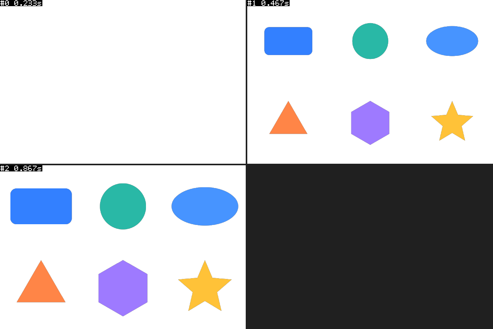

# 六种基础图形续测

日期：2026-10-16（香港时间）。本轮根据用户“允许接着昨天进行测试，可以进行新的构建”续测。

本地开发构建 `dist/AE Browse/` 已生成，支持圆角矩形、圆形、椭圆、三角形、六边形、星形。安装目录仍保留 2026-10-14 版本；本轮没有覆盖扩展安装、修改用户库登记或保存 AE 工程。

本地交付 ZIP：`dist/AE-Browse-basic-shapes-2026-10-16.zip`。打包后逐文件核对 `build-info.json` 的 SHA-256 和文件清单，确认内容与构建目录一致。见[打包证据](../test-results/basic-shapes-1792127866624-56498e/package.json)和[结果汇总](../test-results/basic-shapes-1792127866624-56498e/summary.json)。

## 分层结果

| 验证层 | 范围 | 结果 |
| --- | --- | --- |
| Node 包与预检 | 边界 103、计划 46、库服务 12、通信桥 20、模拟宿主 23、近似预览 5、真实文件库集成 7、构建结构 7 | 223 通过，0 失败 |
| 实际 AE 属性 | 6 种图形 × none/pop/slide/fade；非法星形参数；六图形共存 | 26 通过，0 失败 |
| 真实渲染 | 960×640；插入前、入场过程、入场结束三帧 | 3 张 PNG 成功 |
| 离线像素检查 | 帧尺寸、透明起始帧、六图形范围/填充/增长、过程像素限制在最终形状内 | 9 通过，0 失败 |
| 最新 CEP 交互 | 六图形版本面板加载、停靠、重开、鼠标点击与大库性能 | 本轮未验收 |

Node 边界检查仍读取既有只读宿主清单；这只是离线预检输入，不计为新的 AE 属性实测。`portable-demo` 和 `basic-shapes` 图形包的离线合同校验均通过，离线执行能力标记仍为待宿主检查。

AE 实测环境：26.0x67。运行前是未保存的空工程，项目项数量 0。宿主代码 SHA-256：`57b992f877b1147da1b2bb73027a4c1b3db8b42907565aaeb93c8cbf8f665cc6`。

## 属性与清理证据

最终运行 ID：`basic-shapes-1792127866624-56498e`。临时合成 ID 112，名称 `__AEBrowse_BasicShapes_basic-shapes-1792127866624-56498e`。

[实际属性与清理报告](../test-results/basic-shapes-1792127866624-56498e/ae-properties.json)记录原生几何 matchName、尺寸或边数/半径/旋转、填充、动画通道和关键帧时序、重复操作去重。非法星形内半径在创建前被拒绝。

渲染后删除该临时合成，再扫描项目项确认不存在；项目项和原图层身份清单与基线相同，最终项目项数量 0。没有使用 `itemByID` 检查已删除项，没有调用工程保存。测试增加的撤销记录仍会保留在 AE 中。

## 昨日失败原因

复测先出现 22 通过、4 失败，均为三角形边数断言。详细诊断证明实际边数为 3，而测试中的无括号嵌套三元表达式将预期值算成 6；在本机 ExtendScript 中独立求值也得到 `nested: 6, explicit: 3`。将测试改成明确的 `if/else` 后，使用相同生产宿主代码获得 26/26 通过。

昨日另一个“共存图层数量不符”由失败用例没有删除自己创建的层引起。本轮测试助手在失败后清理该用例新增的层，再继续后续检查，避免连锁误报。生产图形创建逻辑本轮没有另行修改。

最初命令行诊断没有打开临时合成，被宿主保护拒绝，随后已清理；另一次命令行启动出现关闭与脚本中断提示，取消关闭后改用现场确认的本地 AE 脚本桥完成测试。上述尝试不计入最终通过数。

## 三帧与像素

实际采样时间约为 0.2333、0.4667、0.8667 秒；插入时间 0.25 秒，动画时长 0.6 秒。原始 PNG 与 SHA-256 见[捕获元数据](../test-results/basic-shapes-1792127866624-56498e/frames.json)，逐项检查见[像素报告](../test-results/basic-shapes-1792127866624-56498e/pixels.json)。

像素检查使用独立尺寸及颜色预期，原生多边形边缘允许 2 像素栅格误差，RGB 量化允许 1 级误差；逐图形确认过程可见面积大于零且小于结束帧。它证明这三个 pop 采样帧的结果，不代表所有参数、动画中间帧或跨版本渲染完全一致。

## 复现入口

`node scripts/prepare-basic-shapes-test.cjs` 仅准备唯一目录、素材快照和 `run.jsx`，不会启动 AE。显式发送该脚本到 AE 后，必须在独立渲染阶段结束后按报告中记录的 ID 和名称删除临时合成，并扫描回读确认。实机测试不会随 `npm test` 或 `npm run test:cep` 自动运行。

已有三帧可离线复查：`python scripts/check-basic-shapes-pixels.py test-results/basic-shapes-1792127866624-56498e`。需要 Pillow，不连接 AE。
