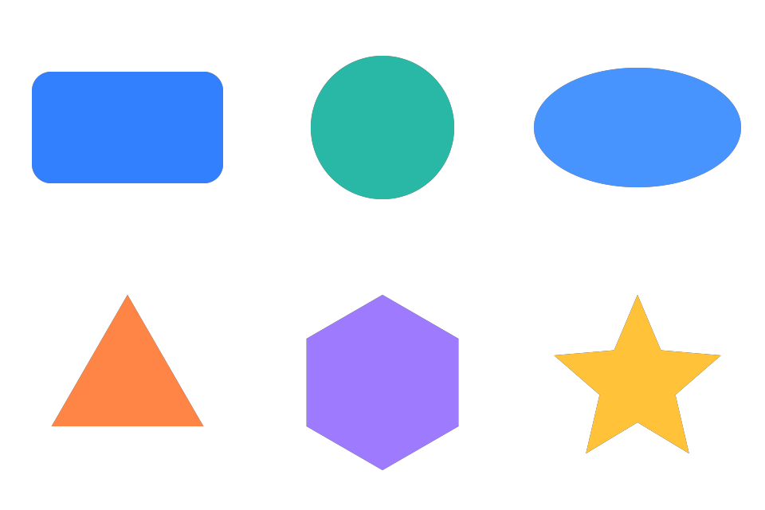

# 构建与一小时分层测试

本轮于 2026-10-17 13:44（香港时间）开始，保留进入任务时已有的未提交实例编辑改动。版本仍为 **0.2.0 开发版**。

已完成。构建与主持续测试窗口为香港时间 13:44–14:44，约 60.42 分钟。恢复型持续测试 55 分钟、同一服务实例测试 20 分钟均结束且为 0 失败；最终收尾整理在用户确认结束后完成。见[机器可读汇总](../test-results/build-20261017-1344/summary.json)。

## 本轮修复

### RGBA alpha 原先只被存储，没有参与真实渲染

修复前，颜色 alpha 为 0 和 0.25 的实例都能回读正确的颜色数组，但原生填充不透明度仍为 100%，实际 PNG 中两个中心像素的 alpha 都是 255。见[修复前像素证据](../test-results/build-20261017-1344/failures/rgba-before.json)。

现在把颜色 alpha 同步为形状填充不透明度，保持图层本身的入场动画。透明度进入手工修改保护与更新回滚范围；完全不透明旧实例的基线格式仍可读取。没有新增面板透明度控件。

修复后，0、0.25、1 的实际 PNG alpha 分别为 0、64、255；另验证六图形 × 四动画的透明度更新、恢复完全不透明、手工修改拒绝和序列化失败恢复。

### 当前 AE 的混合逻辑运算与 Node 存在求值差异

在本机 AE 26.0x67 实测，未加括号的 `true || false && false` 得到 `false`，显式分组后得到预期值。该差异曾让透明度变化漏记，并让资源声明、非法星形角数、格式错误请求绕过部分宿主判断。

已给 JSX 中相应的混合判断添加括号，保持 Node 既有语义。负例先得到 8 项失败，再修复为 9 项全部通过；见[失败记录](../test-results/build-20261017-1344/failures/logic-guards-before.json)及[最终负例结果](../test-results/build-20261017-1344/ae/guards/properties.json)。这个实测结论限定于当前宿主，不推断所有 AE 版本都表现相同。

涉及 `src/native-shape-adapter.jsxinc`、`src/native-shape-plan.jsxinc`、`src/host-dispatch.jsxinc` 和 `src/json-compat.jsxinc`。生成目录由构建脚本产生。

## 分层结果

| 验证层 | 结果 | 范围 |
| --- | --- | --- |
| 常规 Node | 253 通过，0 失败 | 包边界、计划、库服务、协议、编辑状态、预览、示例包、测试准备入口、构建 |
| JSON 差分 | 10008 通过，0 失败 | 固定种子的 10000 组有界数据，与原生 JSON 对照；另含 8 个负例 |
| 大库专项 | 12 通过，0 失败 | 100、1000、5000 项登记、搜索、预检、损坏项隔离及登记恢复 |
| 真实 AE 属性 | 127 通过，0 失败 | 基础图形 26、实例更新 30、透明度 30、逻辑负例 9、往返 27、请求一致性 5 |
| 真实帧与离线像素 | 13 张 PNG，25 项通过 | 基础图形 9、更新 9、alpha 4、往返三个采样帧完全一致 |
| 确定性构建 | 21 文件逐字节一致 | 重建前后包含 build-info.json 的文件校验 |
| 开发 ZIP | 21 文件校验通过 | CRC、逐文件 SHA-256 与构建目录一致 |
| 持续稳定性 | 两组均 0 失败 | 恢复型 55 分钟 / 4249 轮 / 10132 检查组；同一服务实例 20 分钟 / 1548 轮 / 3498 检查组 |

Node 模拟与包预检不计作真实 AE 属性验证。离线 `validate` 未传宿主时仍显示依赖待检查，这是预期提示。

5000 项样例是约 2.35 MB 的紧凑清单，共享一个形状描述源并含一个损坏条目；不是 5000 个独立重型源文件或真实 CEP 滚动性能的结论。本轮最终一次登记约 190 ms，单项预检约 150 ms，仅作本机样例测量。

恢复型长跑跨越了本轮修复过程，新建库服务会重新读取计划源码；同一服务实例的 20 分钟测试在最终源码上启动。两组结果分别保留，不把它们合成同一版本连续运行 75 分钟的结论。内存采样每分钟主动 GC，描述的是该负载下回收后的堆使用。

往返测试包含实际高斯模糊和填充效果、中文目录导出、复制、重建、换合成尺寸和帧率。0.7、1.1、1.5 秒的三个原始/重建 PNG SHA-256 均一致，见[往返结果](../test-results/build-20261017-1344/ae/roundtrip/report.json)。这验证已有底层接口，不表示面板事务导出已交付。

恢复型采样 GC 后堆内存范围为 5.18–5.56 MiB，最后 5.41 MiB；同一服务实例为 5.04–5.36 MiB，最后 5.31 MiB。两组结束后均回读确认登记为空、测试副本字节恢复，未访问用户登记或 AE。

## 测试执行与清理

每轮运行前分别说明 Node、实际 AE 或离线 PNG 范围。普通 Node 套件没有自动启动 AE。

所有实机写入只进入带本轮唯一标识的临时合成。每组结束后删除临时项，扫描项目项确认名称/ID 不再出现，并与原项目项及图层身份基线比较。开始与清理后均为 0 个项目项；未保存或覆盖工程。撤销历史和 dirty 标记可能保留测试活动。

本机 `saveFrameToPng` 异步写入：调用返回时文件尚不存在。早期采样尝试因此未完成；最终执行改为 Node 等待完整 PNG 的 IEND，再请求下一帧，最后清理。属性阶段 `finished` 不等于像素捕获已完成。

最初的命令行启动还遇到崩溃恢复提示及自动退出行为。准备脚本现在显式设置 `app.exitAfterLaunchAndEval = false`。启动器返回码、旧报告或未写完的 PNG 均不作为成功证据。

## 构建与本机开发扩展

- 构建目录：`dist/AE Browse/`。
- 开发 ZIP：`dist/AE Browse-0.2.0-dev-20261017.zip`，172578 字节；这是未签名开发包，不是正式 ZXP。
- 宿主 SHA-256：`a903f8944e754d0cb7af7fe683865bf51d841d7070be7f35505a6e1a2d731922`。
- ZIP SHA-256：`1150da513aca6493cd821a8b7145e16938d0aa187467aa8716717358b09fccb9`。
- 旧安装的 22 个文件已备份并核对于 `test-results/local-only/extension-backup-20261017-1415/`。
- 20 个构建文件已逐一复制并核对，另同步 build-info.json；用户图形库登记 SHA-256 未变化，`.debug.disabled` 保留，没有更改调试注册表。
- 从安装目录重新加载宿主后，只读上下文返回正常，错误请求返回 `E_REQUEST_FORMAT`；见[安装回读](../test-results/build-20261017-1344/installed-readback.json)。

实际 CEP 面板已显示连接成功。本轮鼠标输入被工具的目标检查拒绝：控件属于 `CEPHtmlEngine.exe`，输入目标为 AE 主窗口；激活、刷新后仍被拒绝。因此物理点击、停靠拖拽和关闭重开没有在本轮认证，不用脚本属性结果替代这些交互结论。

浏览器演示另检查了六图形切换、参数编辑、中文检索及空结果状态，无控制台错误；它不连接 AE。截图见[演示检查](../test-results/build-20261017-1344/browser-demo.png)。本轮创建的演示标签与 HTTP 预览服务已关闭。

## 复现入口

以下只运行 Node，会生成测试报告和独立样例，不启动 AE：

```powershell
npm run build
npm test
npm run test:plan
npm run test:cep
npm run validate
node tests/json-differential.cjs
node tests/large-library.cjs
```

持续测试必须显式运行，并指定未使用的新目录。`--persistent` 保持同一个库服务实例，默认模式还覆盖登记重开和主登记损坏恢复；二者都不连接 AE：

```powershell
node --expose-gc tests/soak.cjs 55 test-results/local-only/new-recovery-run
node --expose-gc tests/soak.cjs 20 test-results/local-only/new-persistent-run --persistent
```

以下命令也只准备文件，不执行 AE；生成的 run.jsx 需在单独说明实机影响后显式运行。update、alpha 在完成后保留已标识临时合成供独立像素捕获，必须捕获后删除并扫描确认；logic 自行清理：

```powershell
node scripts/prepare-instance-update-test.cjs
node scripts/prepare-instance-update-test.cjs --suite alpha
node scripts/prepare-instance-update-test.cjs --suite logic
node scripts/prepare-basic-shapes-test.cjs
```

离线 PNG 复核不访问 AE，传入含 frames.json 的本轮结果目录：

```powershell
python scripts/check-basic-shapes-pixels.py test-results/build-20261017-1344/ae/basic
python scripts/check-instance-update-pixels.py test-results/build-20261017-1344/ae/update
python scripts/check-fill-alpha-pixels.py test-results/build-20261017-1344/ae/alpha
```

Node 准备入口的测试使用封闭 VM，在模拟创建合成处主动中断，不把 VM 结果称为实机验证。

## 证据

- [汇总与持续测试状态](../test-results/build-20261017-1344/summary.json)
- [创建属性](../test-results/build-20261017-1344/ae/basic/properties.json)、[更新属性](../test-results/build-20261017-1344/ae/update/properties.json)、[透明度属性](../test-results/build-20261017-1344/ae/alpha/properties.json)
- [透明度像素](../test-results/build-20261017-1344/ae/alpha/pixels.json)、[往返与效果](../test-results/build-20261017-1344/ae/roundtrip/report.json)
- [安装校验](../test-results/build-20261017-1344/installation.json)、[确定性构建](../test-results/build-20261017-1344/deterministic-build.json)、[ZIP 校验](../test-results/build-20261017-1344/archive.json)


