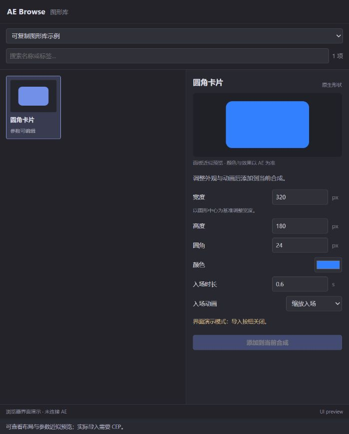

# CEP 0.2.0 构建与验证记录

本报告保留构建阶段记录。后续已进行真实 CEP、AE 属性与帧检查，见 [实机报告](CEP_LIVE_TEST_REPORT.md)，不要把下文“本轮未进入 AE”当作最新实机状态。

日期：2026-10-14（香港时间）。本轮根据既定实现路径完成阶段 0–2 所需的代码与开发构建；实际 CEP 与 AE 面板闭环尚未验收。

## 本轮产物

- CEP manifest、官方固定版本 CSInterface、HTML/CSS/JS 面板与可重复开发构建。
- 图形库异步读取、独立持久登记与恢复、内容/版本冲突提示、缓存搜索、损坏素材隔离。
- Node 校验器对同一有界字节快照预检；执行前再次比对指纹。发送所选素材清单片段，健康素材不携带其他损坏素材的数据。
- 固定 JSON 宿主分发、ES3 JSON 支持、上下文/身份与操作预算保护、稳定操作 ID、串行队列与结果待确认锁。
- 圆角卡片参数、面板近似预览、“添加到当前合成”和创建后回读入口。
- 开发安装脚本与说明；安装脚本本轮没有执行，注册表调试配置没有更改。

## Node 验证

执行前已单独说明：以下检查在系统 Node 24.18.0 中运行，不调用 AE，写本地测试报告和隔离样例。计数包含用例和按功能组织的检查组，不是实际 AE 属性断言数量；CEP 内置 Node 版本与兼容性仍需实机确认。

| 分类 | 通过 | 失败 | 当前证据 |
| --- | ---: | ---: | --- |
| 原有包与模拟宿主预检 | 103 | 0 | `test-results/boundaries.json` |
| 原有 ES3 计划在 Node VM 中编译 | 35 | 0 | `test-results/native-plan.json` |
| 库服务检查组 | 12 | 0 | `test-results/library-service.json` |
| CEP 传输和队列模拟 | 20 | 0 | `test-results/host-bridge.json` |
| 正式 JSX 分发器与属性模拟 | 20 | 0 | `test-results/host-dispatch.json` |
| 扩展包结构与加载 | 7 | 0 | `test-results/cep-build.json` |
| 合计 | 197 | 0 | 全部为 Node 层 |

原有包预检读取的 `ae-host.json` 是已有效果快照，不代表本轮读取了真实 AE。新增宿主测试使用实际计划/适配器代码配合 Node VM 中的模拟 AE 对象；它验证接口与保护行为，不证明真实 ExtendScript 属性行为。

## 浏览器界面检查

在本机演示模式查看真实 HTML/CSS/JS：中文名称与控件可见；调整宽度和动画选项可回读；不存在的关键词显示 0 项与空结果提示，清空后恢复；360 px 宽度下主区切换为可滚动单列，文档宽度与视口均为 360 px，没有横向溢出。演示导入按钮关闭。

该检查使用普通浏览器，不证明 CEP 内置 Chromium 的加载、目录选择、停靠、重开或滚动性能，也不属于真实 AE 像素检查。

## 实机与像素验证状态

本轮没有进入真实 AE，没有创建测试合成，没有保存或覆盖用户工程。CEP 加载、实际运行时版本、实际面板导入与属性回读、失败清理、渲染像素检查均待下一阶段。已有 AE/像素记录保留在 [往返测试报告](ROUNDTRIP_TEST_REPORT.md)，不计入本轮新增通过数。

原生选色、预制动画、收藏、实例更新/事务导出、虚拟滚动、签名 ZXP 和安装升级验收尚未实现。当前不是正式发布包。
