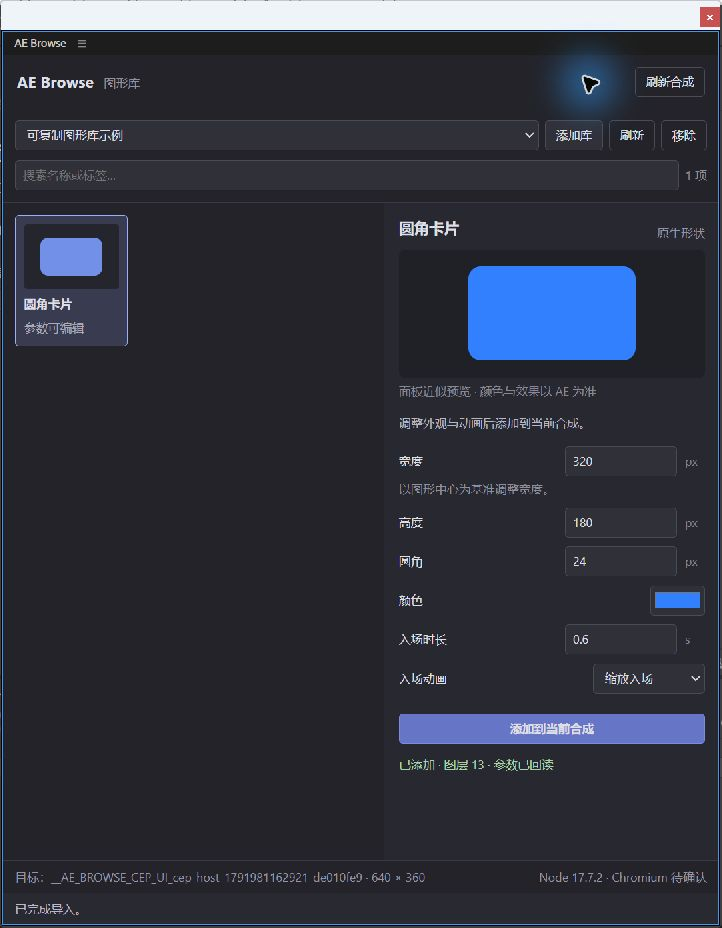
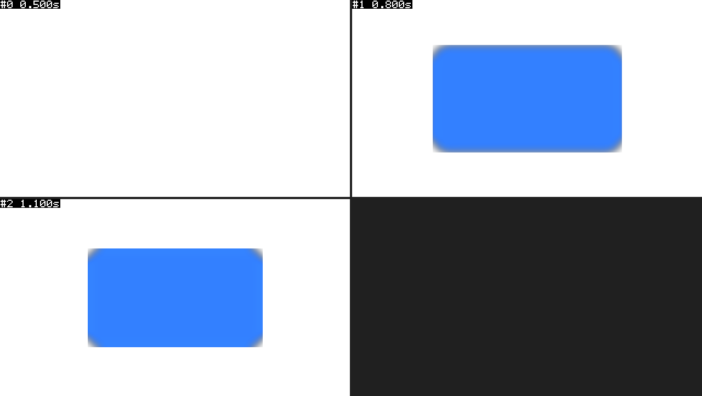

# CEP 0.2.0 实机验证

日期：2026-10-14（香港时间）。用户明确允许实机测试；执行前分别说明了只读、属性、帧采样和清理范围。

## 结果

| 验证层 | 本轮结果 | 范围 |
| --- | --- | --- |
| Node 包/预检 | 沿用上一轮 197 个用例/检查组通过记录 | 不混算为 AE 实测 |
| 正式 JSX 实际属性 | **16 通过、0 失败、0 跳过** | 尺寸/颜色、四种动画、身份、幂等、冲突、目标保护与失败清理 |
| 实际 CEP 最小闭环 | **通过** | 加载 → 登记示例库 → 从面板创建 → 回读图层 13 |
| 真实帧与变化范围 | **3 个采样帧成功** | 0.5 / 0.8 / 1.1 秒；最终变化 bbox 为 x=160,y=90,w=320,h=180 |
| 临时合成清理 | **通过** | 属性测试、失败预览和面板测试合成都删除，最终项目扫描为 0 项 |

环境：Windows、AE **26.0x67**。真实面板页脚读回内置 Node **17.7.2**；CEPHtmlEngine 文件版本 **12.0.1**，PlugPlug 日志 **12.0.1.2**，Chromium 安装文件版本 **99.0.4844.84**。页脚暂未从 process.versions 读出 Chromium，显示待确认。

宿主分发器读取 1583 个效果，正确返回无合成和临时合成上下文。实际检查使用构建产物，host.jsx SHA-256：`426e4cd7e7b06b73d9f9029370e49ea28640cbe25ce813b0c963acbf5790c73a`。

## 实际属性与测试驱动修正

覆盖尺寸、圆角、颜色与关键帧回读；pop/slide/fade/none 通道、数量、值和相对时间；实例身份与相同操作 ID 复用；不同参数冲突保留原实例；无合成、错误目标、非法参数、缺失必需效果提前停止；无效必需效果属性路径清理新图层；失败后仍能创建。

[最终 16 项记录](../test-results/cep-host-1791981162921-de010fe9/cep-host-report.json)。首次有效运行 14 通过、2 失败：[失败记录保留](../test-results/cep-host-1791980929593-15c2265d/cep-host-report.json)。失败在测试断言：嵌套条件分派，以及 Position 回读附带的 Z=0 分量。改为明确 if/else，严格核对 X/Y 与零深度后，用新编号重测；执行适配器未因此改动。

MCP 每次执行不保留先前局部 JSX 定义，所以构建代码与测试在同次求值中组合。分发器和测试分别关闭自己打开的 Undo 组，恢复调用显式清除继承的 wrapper。AE 没有 Undo 深度查询，后续调用成功不等同撤销历史完全恢复。

## 实际面板

开发扩展安装到 `%APPDATA%/Adobe/CEP/extensions/local.aebrowse`。原有 PlayerDebugMode 已为 1，本轮没有改注册表，也没有签名 ZXP。

为重新扫描扩展，启动独立空实例，并设置 `app.exitAfterLaunchAndEval=false`。启动报告确认无工程文件、0 个项目项，菜单命令 5068 能打开 AE Browse。第一次独立启动出现过恢复对话框和退出，日志不能确定退出原因；后续启动与闭环已验证。

嵌入式 CEP 控件无法被自动点击工具可靠绑定，库选择和导入按钮由用户完成。随后通过维护的 AE MCP API 回读：layerId=13，尺寸 320×180，圆角 24，颜色约 `[0.2,0.5,1,1]`，pop、0.6 秒，`modified=false`。颜色按 AE 浮点精度比较。

示例库登记保留在 `%APPDATA%/AE Browse/libraries.json`，来源为 `D:/project/ae-browse/examples/portable-demo`。来源文件未被面板改写。用户放大窗口后完整参数和底部按钮可见；实际停靠、关闭重开恢复和其他尺寸尚未完整验收。

## 真实帧与像素

实际面板实例保存了三个 640×360 PNG：开始为空、0.8 秒过冲、1.1 秒到达最终尺寸。示例含可选高斯模糊，实际外观与面板近似预览有差异，近似预览不是像素基准。

开始与最终帧比较，57600 像素变化，bbox 为 `[160,90,320,180]`，与合成中心的卡片边界一致。这只验证当前样例与采样时间的变化范围，不外推所有帧、效果、机器或色彩设置，也不是导出再重建的像素往返测试。

[面板实际回读](../test-results/cep-ui-readback.json) · [帧、像素比较及最终清理](../test-results/cep-ui-live-report.json)。

## 清理与后续

删除按实际 ID 和完整临时名称匹配，随后扫描确认不存在，没有使用删除后的 itemByID。一次删除后的失效对象引用使返回报错，但扫描证实删除已完成；修正为删除前缓存布尔状态。最初的帧预览被原 AE 的脚本选择对话框阻塞，未计通过，取消对话框后也完成了清理。

原工具连接进程随后退出，端点返回 HTTP 502；连接到仍运行的独立实例后，用同一套维护的 MCP 工具 API 完成回读、渲染和清理，没有重发创建请求。最终独立实例扫描为 0 项。

没有保存或覆盖用户工程。测试影响 dirty 标志、撤销历史和窗口布局，不宣称完全恢复。开发面板、示例登记和空的独立 AE 窗口保留供使用。

阶段 0–2 的基础加载、登记和最小导入闭环已实测。停靠/重开恢复、快速重复点击、超时交互和大库性能仍需专项验收；原生选色、预制动画、收藏、实例更新/事务导出及 ZXP 按后续阶段推进。
