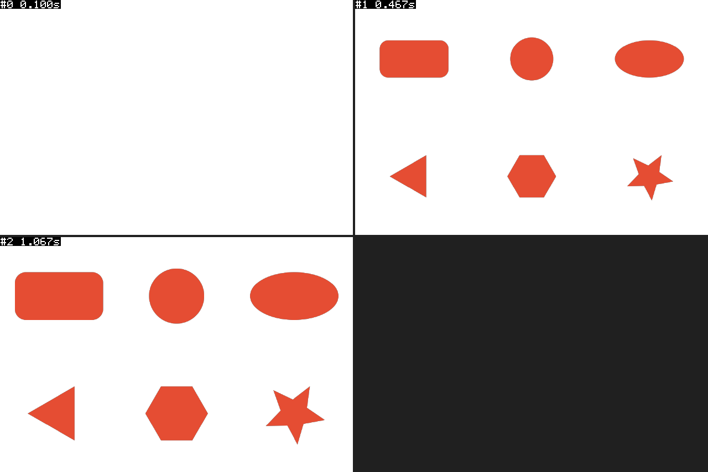

# 实例读取与外观更新验收

日期：2026-10-17，香港时间。开发版本仍为 0.2.0。本轮交付“读取所选实例 → 修改外观 → 更新同一图层”，保留原动画。

## 已交付

- 新增“读取所选实例”“更新所选图形”和当前编辑图层提示。参数回填；动画类型和时长锁定；副本通过独立创建操作执行。
- 更新绑定合成、图层、实例 ID、来源包版本/内容，以及读取时的参数和属性快照。选择变化、旧快照、手工修改、锁定、来源变化均拒绝更新。
- 更新事务覆盖属性写入、基线计算、实例信息写入、回读和结果序列化。失败后逐项恢复属性与原始 comment，再回读确认；无法确认恢复时明确报错，不删除已有图层。
- 更新超时保持宿主锁且不重试，迟到回调解锁后要求重新读取。预检使用原插入时间，时间指示器移动不会改变原动画的校验基准。

## 分层验证

| 验证层 | 本轮结果 | 边界 |
| --- | --- | --- |
| Node 包、计划、服务、协议、模拟属性与构建 | 240 项通过，0 失败 | 不进入 AE；新增 11 组宿主回归和 6 组编辑状态检查 |
| 真实 AE 属性 | 30 项通过，0 失败 | 六图形 × 四动画更新，另含选择变化、锁定、来源变化、手工修改、序列化失败恢复和旧快照保护 |
| 实际 CEP 面板 | 六图形创建/读取/更新、重复点击、选择变化、超时/迟到、关闭重开恢复通过 | 实际 CEP 事件处理器及开发调试接口驱动，不是普通浏览器模拟 |
| 真实渲染 | 3 张 PNG | 更新后六图形，插入前、入场中、入场后三个采样点 |
| 离线像素 | 9 项通过，0 失败 | 画布、透明起始帧、六图形范围/颜色/入场增长、范围约束 |

各层分别统计。包预检仍使用既有只读宿主清单，不计作新的实际 AE 读取。环境：AE 26.0x67、CEP 12.0.1、CEP Node 17.7.2。被测构建的宿主 SHA-256 为 `9f77ec95330e6d39a65c10883d4c9322ba254453e0f4f4f1c212729edc933d18`。

Node 回归先观察到入口缺失的 11 组失败，再实现复测。分别注入属性、基线、comment、回读、序列化失败验证恢复；持续恢复失败会返回 `E_ROLLBACK_FAILED`。实际 AE 中另注入结果序列化失败，确认真实属性及原始实例信息恢复。

真实 CEP 将一次实际更新回调延迟 24 秒，产品超时仍为 20 秒。超时后创建/更新保持锁定，迟到回调后解锁并清空编辑状态，只执行一次更新，图层数保持为 6。关闭扩展后调试连接断开，重新打开后两套库登记恢复、旧编辑状态清空。

## 清理与安装

两轮临时合成均删除，并扫描确认项目项恢复为 0，没有保存工程。AE 撤销历史和 dirty 标记可能保留。实际 ID、名称和扫描见各报告。

开发扩展已逐文件升级，20 个构建文件 SHA-256 全部核对。原版 19 文件备份并校验于 `test-results/local-only/extension-backup-20261017-0830/`。原库登记保留，新增 basic-shapes 登记；没有修改调试注册表。临时 CEP 调试配置不进入构建包，收尾时在安装目录改名为 `.debug.disabled` 保留内容并停用，关闭调试连接后重开面板。

`AfterFX -r` 没有产生本轮报告，不作为成功证据；真实脚本经现场确认端口的本地 AE 脚本桥执行。正式面板不依赖此测试桥。

## 证据与复现

- [汇总](../test-results/update-20261017/summary.json)
- [AE 属性与清理](../test-results/update-20261017/ae-properties.json)
- [真实 CEP 与清理](../test-results/update-20261017/cep-panel.json)
- [帧元数据](../test-results/update-20261017/frames.json)、[像素结果](../test-results/update-20261017/pixels.json)
- [实际面板编辑状态](../test-results/update-20261017/cep-panel-editing.png)

`node scripts/prepare-instance-update-test.cjs` 仅准备唯一目录和 run.jsx，不启动 AE。显式执行后保留临时合成供独立渲染，必须按报告 ID/名称清理并扫描确认，不保存工程。错误场景会尝试在脚本内清理；此宿主测试不加入普通 Node 套件。

`python scripts/check-instance-update-pixels.py <本轮目录>` 仅读 PNG，需要 Pillow，不连接 AE。

## 未验收

物理鼠标操作 CEP 子窗口、停靠拖拽、窄面板长期交互、大库滚动/内存及跨 AE 版本待专项检查。Windows 自动化的目标检查拒绝直接操作 CEP 子窗口，因此本轮面板功能用真实 CEP 事件处理器驱动，不声称物理鼠标已认证。

更新不重写动画。事务导出、收藏、预制动画预览、AE 原生选色和签名 ZXP 仍未交付。
