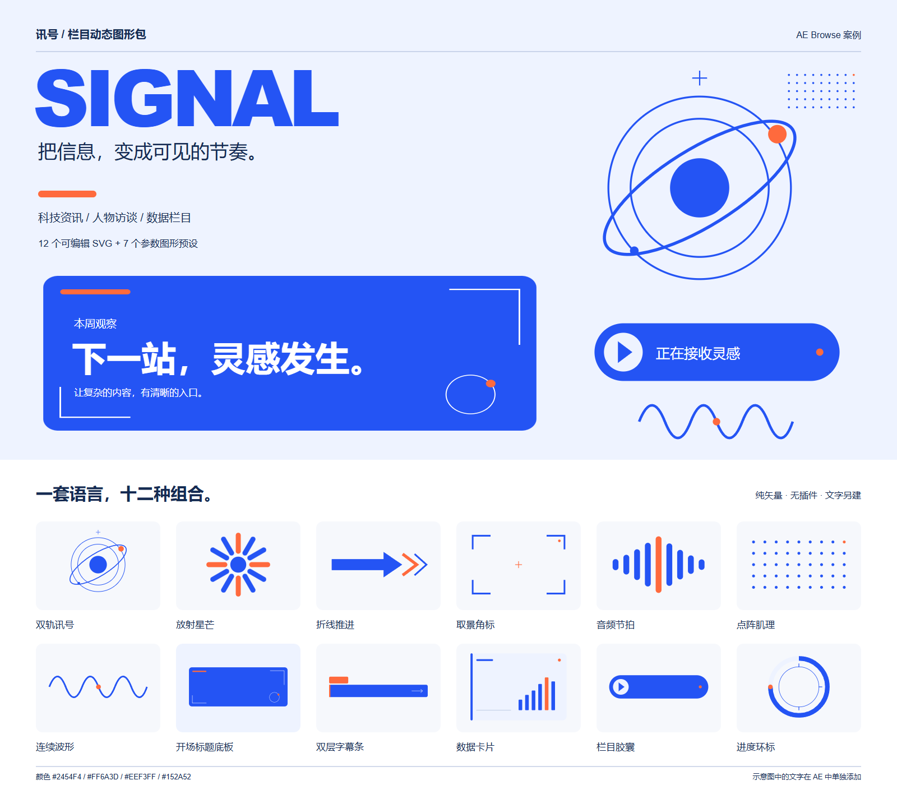

# 讯号 SIGNAL 图形包案例

用于科技资讯、播客访谈、数据栏目。蓝色负责主信息，橙色标记节奏点，浅蓝承担底板。原创矢量几何，无外部图片、字体或插件依赖。

## 在 AE Browse 使用

1. **参数图形包**：来源管理 → 添加图形库 → 选择本目录（包含 pack.json）。7 个预设支持尺寸、颜色、入场时长和 pop / slide / fade / none。添加后可读取、更新所选实例。
2. **完整复合图形**：把本目录下的 **svg** 文件夹拖入面板，或作为普通本地素材文件夹添加。12 个素材分为“装饰”和“版式”，默认选择“可编辑形状”。导入后各图形元素位于同一个原生形状层的分组内，可在 AE 中改色、编辑路径、添加动画。
3. 双击 preview.html 查看组合示意。overview.svg / overview.png 是展示板，不应作为单个组件导入。复制本目录即可携带全部案例文件。

**两种来源分别添加**：pack.json 中的 7 项是单图形参数预设；SVG 中的 12 项是完整组合，不使用参数包的读取/更新按钮。当前图形包协议不直接承载多组复合版式。

## 组件

| 素材 | 推荐用法 |
| --- | --- |
| 双轨讯号 | 片头主视觉；可拆分轨道和卫星分别旋转 |
| 放射星芒 | 节奏点、重点强调或缩放转场 |
| 折线推进 | 段落切换或内容推进方向 |
| 取景角标 | 视频取景框；中心可放画面 |
| 音频节拍 | 声音、访谈、播客的节奏标识 |
| 点阵肌理 | 用于版面空白区域；不建议铺满整个画面 |
| 连续波形 | 数据、信号或连接关系的辅助线 |
| 开场标题底板 | 标题放在 x=64…744、y=100…264 内；文字在 AE 另建 |
| 双层字幕条 | 上方短标签，下方姓名或标题；保留右侧箭头 |
| 数据卡片 | 左侧填写数值，右侧为装饰性趋势柱；无真实数据含义 |
| 栏目胶囊 | 文字放在 x=142…454；适合栏目名或行动提示 |
| 进度环标 | 静态 75% 视觉示例；真实进度需在 AE 编辑路径或添加修剪路径 |

素材透明背景，不含文字。组合示意中的标题、姓名、数字需在 AE 另建文字层；这样可以替换内容与字体。数据卡片的柱状图仅为装饰，进度环是静态 75% 示意。

## 建议的 4 秒片头

- 1920×1080、30 fps；底色 #EEF3FF。先用标题底板作为信息承载区，再把双轨讯号放在右侧。
- 0.00–0.55 s：标题底板从左侧进入，透明度 0→100，位置使用缓出。
- 0.12–0.62 s：标题文字向上移动约 24 px 并淡入。
- 0.24–0.80 s：双轨讯号从 85% 缩放至 100%，轨道做慢速旋转。
- 0.45–0.85 s：栏目胶囊入场；橙色圆点延迟约 3 帧弹出。
- 0.85–3.20 s：保持阅读；3.20–4.00 s：折线推进从左向右扫过切入正文。

以上是搭建建议；本案例未自动创建 AE 合成，也未把该片头动画封装为模板。参数预设只包含现有适配器支持的入场动画。

## 配色与文件

- 主蓝 #2454F4，强调橙 #FF6A3D，浅蓝 #EEF3FF，深蓝 #152A52，辅助灰蓝 #A4B5D6。
- pack.json + assets/：7 个参数预设；svg/：12 个复合图形；catalog.json：尺寸、用途和相对路径索引。
- scripts/create-signal-kit.cjs 从仓库根目录通过 node 运行，可重建本案例的文本和矢量文件；overview.png 由离线浏览器渲染生成。

## 使用许可

本案例中原创图形允许复制、修改及商用。不包含第三方素材；不对仓库其他代码与 Adobe 依赖的许可作任何变更。
